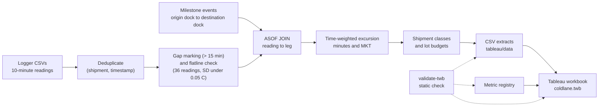

# coldlane

[](https://github.com/SlateGitOrg/coldlane/actions/workflows/ci.yml)


coldlane analyses temperature-logger data from 2-8 C biologic shipments. It integrates time out of range over the logger's reading intervals, pins every excursion minute to the leg of the journey where it was recorded, computes mean kinetic temperature with the Arrhenius definition, and treats missing or stuck logger data as unknown instead of in range. Shipments are classified as reject, indeterminate, excursion within budget or compliant, each lot's stability budget is tracked across its shipments, and the results are exported as CSV extracts for a Tableau workbook that a static validator checks against the extracts and a metric registry. All data in this repository is synthetic.

## The problem

A specialty-pharmacy 3PL ships 2-8 C biologics from one central hub to hospital pharmacies, by air and by ground, with a data logger in every insulated shipper. The usual QA check counts the readings above 8 C in each shipment. That has three problems:

- Ten minutes at a hospital dock counts the same as four hours on a summer tarmac, so QA cannot tell a harmless blip from a real heat exposure.
- Logger intervals that are missing are silently read as in range. A shipment whose logger went quiet on the tarmac looks cleaner than one that was measured.
- Nobody can see which hub or leg causes the excursions, or how much of a lot's stability budget its shipments have already used.

coldlane replaces the reading count with time-weighted minutes per leg, keeps the missing time visible, and rolls the minutes up to lot level against the product's stability allowance (product A 72 h, B 24 h, C 6 h).

## How it works



1. **Ingest** (`coldlane ingest`) loads the per-shipment logger CSVs and the milestone events into DuckDB. Re-uploaded rows with the same shipment and timestamp are collapsed to one. A spacing above 15 minutes between readings is a gap. A logger whose standard deviation is below 0.05 C over 36 consecutive readings is flatlined.
2. **Leg assignment** is a DuckDB `ASOF JOIN` of each reading to the latest milestone at or before it. The legs are origin dock, linehaul, hub dwell, tarmac, flight, last mile and destination dock.
3. **Time-weighting.** A reading covers the interval to the next reading, capped at 10 minutes. Anything beyond the cap is missing time: it is neither in range nor out of range. A reading's minutes belong to the leg that reading was taken in.
4. **Per shipment:** minutes above 8 C and below 2 C, maximum and minimum, mean kinetic temperature (delta H = 83.144 kJ/mol, R = 8.3144621 J/(mol K), weighted by covered minutes) and coverage.
5. **Classification**, in this order:
   - *reject*: any reading at or below 0 C or above 25 C, or cumulative time between 8 and 25 C over the product allowance;
   - *indeterminate*: a gap of at least 30 minutes that overlaps a tarmac or hub-dwell leg, or a flatlined logger;
   - *excursion within budget*: any computed minute out of range;
   - *compliant*: everything else.
6. **Lot budget:** minutes out of range summed over all shipments of a lot, against the allowance of the lot's product.
7. **Export and workbook.** `coldlane export` writes `shipment_summary.csv`, `leg_excursions.csv` and `lot_budget.csv` to `tableau/data/`. `tableau/coldlane.twb` reads them through relative textscan connections and has four worksheets (Lane x Leg Heatmap, Hub Pareto, Lot Budget Burn, Monthly Trend) and one dashboard. Its calculated fields are named as in the registry in `src/coldlane/registry.py`: Excursion Minutes, Excursion Rate, Indeterminate Rate, Reject Rate, Budget Used % and Avg MKT, plus Cumulative Excursion %, a running-total table calculation that draws the cumulative line of the Hub Pareto on a second axis.

### The synthetic data

`coldlane generate` writes one origin hub, 6 lanes (2 air via HUB-B, 4 ground), 12 months, 1,200 shipments of 3 products in 300 lots, and about 200,000 readings. The generator is seeded and deterministic and also writes a `manifest.json` of what it injected, which the tests compare against what the analysis recovers.

In-box temperature follows the ambient temperature of the current leg through a first-order lag. Warming uses a 6 h time constant. Refrigerated legs (cold rooms, reefer trucks, the active container in the aircraft hold) pull the payload back down with a shorter 0.75 h constant. That 0.75 h value is a modelling choice, not a measurement: it was chosen so that a refrigerated leg re-chills the box. With a single 6 h constant a 3 h tarmac dwell leaves the box above 8 C for most of the flight that follows. The concentration of excursion minutes on the tarmac in the example output below follows from that choice together with the injected tarmac dwell, so it shows that the pipeline recovers a planted pattern. It is not an independent finding about real air freight.

Injected patterns:

- every June-August air shipment sits 2-4 h on the HUB-B tarmac at 28-34 C
- 9 shipments carry loggers from batch LG-7 that are stuck at 5.0 C
- 40 shipments have a 50-90 minute logger gap; 12 of them overlap a tarmac or hub-dwell leg and the other 28 lie wholly inside a linehaul or flight leg
- 8% of deliveries have a single reading above 8 C on the destination dock (10 minutes)
- 5 winter ground shipments dip below 0 C during linehaul
- 2% of the readings are uploaded twice

The gap, LG-7, freezing and dock-spike shipment sets are disjoint. `sample/` holds three shipments copied from the seeded output (a summer air shipment with a tarmac excursion, a compliant ground shipment and an air shipment with a gap on the tarmac).

## Quick start

Python 3.11 or newer.

```bash
python -m venv .venv && . .venv/bin/activate
pip install -e ".[dev]"

coldlane generate --out data
coldlane ingest --data data --db coldlane.duckdb
coldlane analyse --db coldlane.duckdb
coldlane export --db coldlane.duckdb --out tableau/data
coldlane validate-twb tableau/coldlane.twb
coldlane report --db coldlane.duckdb
```

To try the committed three-shipment sample instead of the full dataset:

```bash
coldlane ingest --data sample --db sample.duckdb
coldlane analyse --db sample.duckdb
coldlane report --db sample.duckdb
```

To open the workbook, open `tableau/coldlane.twb` in Tableau Desktop. The connections are relative, so keep `tableau/data/` next to it.

## Example output

From `coldlane generate`, `ingest`, `analyse` and `report` with the default seed:

```text
$ coldlane ingest --data data --db coldlane.duckdb
{
  "shipments": 1200,
  "rows_uploaded": 204689,
  "readings": 200675,
  "duplicates_removed": 4014,
  "conflicting_duplicates": 0,
  "gaps": 40,
  "risk_gaps": 12,
  "flatlined_shipments": 9
}
```

Classification counts:

| class | shipments | share |
|---|---|---|
| reject | 5 | 0.4% |
| indeterminate | 21 | 1.8% |
| excursion_within_budget | 215 | 17.9% |
| compliant | 959 | 79.9% |

Top 5 lane x leg cells by excursion minutes:

| lane | leg | excursion minutes | share of all |
|---|---|---|---|
| AIR-MIA | tarmac | 7410 | 31.4% |
| AIR-SEA | tarmac | 6460 | 27.4% |
| AIR-MIA | flight | 2580 | 10.9% |
| AIR-SEA | flight | 2290 | 9.7% |
| GND-ATL | linehaul | 1490 | 6.3% |

The 5 lots closest to their stability budget:

| lot | product | allowance min | minutes used | budget used | status |
|---|---|---|---|---|---|
| LOT-244 | C | 360 | 650 | 180.6% | over |
| LOT-238 | C | 360 | 470 | 130.6% | over |
| LOT-138 | C | 360 | 410 | 113.9% | over |
| LOT-149 | C | 360 | 380 | 105.6% | over |
| LOT-103 | C | 360 | 360 | 100.0% | within |

Where the tarmac concentration shows depends on the grain. At lane x leg grain, as in the table above, the two air lanes each have a tarmac cell (AIR-MIA 31.4% and AIR-SEA 27.4% of all minutes), and the top single cell is AIR-MIA tarmac. At site grain, as the Hub Pareto groups the data, HUB-B tarmac is one cell for both air lanes: it is the largest site and holds 13,870 of the 19,600 excursion minutes in June-August (70.8%), so the criterion "HUB-B air tarmac holds at least 60% of June-August minutes" is stated and tested at site grain. The same 13,870 minutes split by lane are the two tarmac cells above. The 21 indeterminate shipments are the 12 with a gap over a risky leg and the 9 stuck LG-7 loggers; the 5 rejects are the planted winter freezes.

## Design decisions

**Missing time is unknown, not in range.** A reading covers at most 10 minutes, and the rest of a longer spacing is reported as missing minutes and lowers coverage. A shipment with a gap of 30 minutes or more over the tarmac or in a hub dwell becomes indeterminate even if every recorded reading was in range. The cost is that a few shipments that were probably fine (a logger that dropped out in a cold room) are held back from compliant, and QA has to review them. A gap on a linehaul or flight leg does not change the class; that boundary is a judgement call encoded in `RISK_LEGS`.

**Minutes belong to the leg where the box was out of range, not where the heat entered.** Because the payload lags the ambient temperature, a box that warmed on the tarmac is still above 8 C early in the flight, and those minutes are attributed to the flight. The HUB-B tarmac site cell holds 70.8% of June-August minutes, not 100%, and how much spills into the flight depends on the 0.75 h re-chill constant described under the synthetic data. The alternative, charging the flight's minutes back to the tarmac, needs a causal model of the shipper and would make the heatmap harder to audit. Each reading's minutes go to the leg of that reading, so up to 10 minutes can fall on the wrong side of a milestone.

**One activation energy for every product.** MKT uses 83.144 kJ/mol for all three products and weights readings by covered minutes. The last reading of a series has no following interval and carries zero weight. MKT is tested against hand-computed values and against the property that it is never below the weighted arithmetic mean. A product with a known, different activation energy would need a per-product constant in `config.py`.

**DuckDB for the data work, numpy for MKT.** The deduplication, `ASOF JOIN`, interval and window logic is SQL, which keeps the leg assignment a single readable statement. MKT is computed in numpy because the exponentials are summed in log space, which does not underflow for hot series. The cost is two places that touch the numbers: SQL for covered minutes, Python for MKT, with the classification rules in a pure Python function that is easy to test in isolation.

**Conflicting duplicate readings keep the warmer value.** Exact re-uploads are collapsed. If two uploads of the same timestamp disagree, the warmer reading is kept and the conflict is counted in the ingest summary. That is conservative for a product with an upper limit and slightly optimistic about cold excursions; the generator never produces conflicts, so this path is covered by a unit test only.

**The workbook is validated statically.** Tableau cannot run in CI. `validate-twb` parses the XML and checks that every datasource points at an existing CSV through a relative directory, that every field a calculation or worksheet references is a column of that CSV or a calculated field, that the calculated-field captions and formulas equal the registry, that the four worksheets and a dashboard exist, that the Hub Pareto carries its cumulative table calculation on a second pane, and that no attribute holds an absolute path. That catches renamed columns and drifting metric names. It does not prove the workbook renders as intended; the XML is hand-written in the Tableau 2023 format and has not been opened in Tableau Desktop by the test suite, so the Hub Pareto's dual-axis and table-calculation XML in particular is checked structurally only.

## Testing

```bash
pytest -q
ruff check .
ruff format --check .
```

The suite runs offline in a few seconds. It covers:

- MKT against hand-computed values, constant series, 200 random series (MKT is never below the mean), weights and numerical stability
- the time-weighting fixture (readings above 8 C at minutes 0, 10 and 20 and the next reading at minute 60 give 30 excursion minutes and 30 missing minutes) and the lot fixture (a product C lot with 40 and 50 minutes above 8 C has used 90 minutes, 25% of its budget)
- ingest rules on hand-built datasets: duplicates, the `ASOF JOIN` boundaries, gaps of 29, 30 and 16 minutes, and flatline windows of 35 and 36 readings
- every classification rule and its precedence
- the full seeded dataset: deduplication removes exactly the injected duplicates, the flatline detector returns exactly the nine LG-7 shipments, exactly 12 gap shipments are indeterminate because of gaps and the other 28 keep their computed class, the 5 freezing shipments are the only rejects, dock spikes are never rejects, and the top lane x leg cell is an air-lane tarmac, and at site grain HUB-B tarmac is the top cell holding at least 60% of June-August excursion minutes
- the workbook validator: the committed workbook passes, and a renamed CSV column, a changed caption or formula, an absolute path, a missing worksheet, a dashboard zone that is not a worksheet or a Hub Pareto without its cumulative line each fail with a message that names the field

## Project layout

```text
src/coldlane/
  config.py      thresholds, allowances, legs, lanes
  generate.py    seeded synthetic data and the injected-pattern manifest
  ingest.py      DuckDB loading, deduplication, ASOF leg join, gaps, flatlines
  metrics.py     mean kinetic temperature and weighted mean
  classify.py    reject / indeterminate / excursion / compliant rules
  analyse.py     shipment summary, leg excursions, lot budgets
  registry.py    the metric registry shared by SQL, CSVs and the workbook
  export.py      CSV extracts
  twb.py         static validator for the Tableau workbook
  report.py      markdown report
  cli.py         typer command line
tableau/
  coldlane.twb   workbook: 3 datasources, 4 worksheets, 1 dashboard
  data/          the CSV extracts it reads
sample/          three shipments of logger data
tests/           pytest suite
```

## License

MIT. See [LICENSE](LICENSE).
